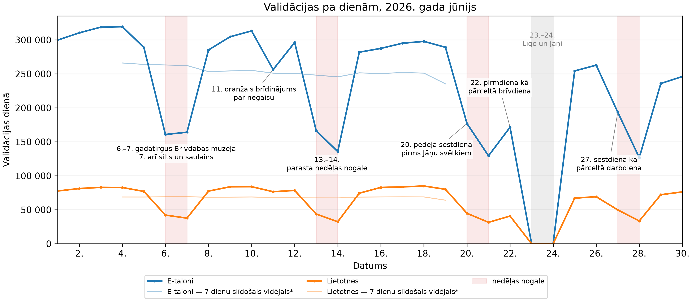
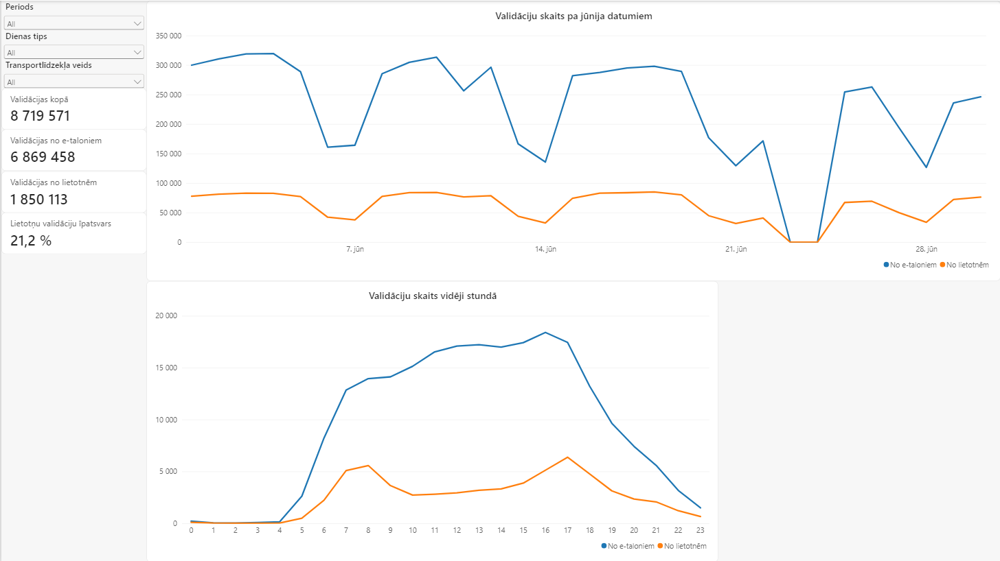

# Rīgas satiksmes validāciju analīze: 2026. gada jūnijs

Rīgas satiksmes sabiedriskajā transportā 2026. gada jūnijā reģistrēta 8 719 571 validācija: 6 869 458 no e-taloniem un 1 850 113 no lietotnēm. Analīzē salīdzināti abi kanāli pa stundām, nedēļas dienām un maršrutiem, nošķirta gadatirgus un laikapstākļu ietekme 7. jūnijā, izsekota Jāņu ietekme līdz mēneša beigām un aprakstītas datu īpatnības.

- **[Kopsavilkums vienā lapā (PDF)](Rigas_satiksmes_validacijas_2026-06_kopsavilkums.pdf)**
- **[Pilnā analīze nbviewer vietnē](https://nbviewer.org/github/gustspetersons/rs-validacijas/blob/main/Rigas_satiksmes_validacijas_2026-06.ipynb)**: tur tabulas un grafiki izskatās tāpat kā Jupyter vidē.
- **[Power BI pārskats](#power-bi-pārskats)** (`powerbi/`), atverams programmā Power BI Desktop



## Galvenie secinājumi

- Katra piektā validācija ir no lietotnes (21,2 %), un jūnija gaitā šis īpatsvars ir stabils.
- Lietotņu validācijas darbdienās vairāk koncentrējas sastrēgumstundās: 7:00–8:59 un 16:00–17:59 kopā veido 39 % dienas validāciju, e-taloniem 29 %.
- 7\. jūnija pieaugumu galvenokārt noteica laikapstākļi, nevis gadatirgus: 81,5 % papildu e-talonu validāciju bija maršrutos, kurus gadatirgus neskāra.
- Datos ir īpatnības: 55 e-talonu validācijas bezmaksas Līgo un Jāņu dienās; slēgts maršruts, kas datos parādās 26 dienās; maršrutu nosaukumi, kas mainās pirms izmaiņu spēkā stāšanās.

Visi secinājumi ir analīzes sadaļā „Galvenie secinājumi”.

## Power BI pārskats



Citi ekrānuzņēmumi: [lapa „Maršruti”](atteli/powerbi_2_marsruti.png), [datu modelis](atteli/powerbi_3_modelis.png) un [lapa „Maršruti” lietotājam ar piekļuvi tikai tramvajiem un trolejbusiem](atteli/powerbi_4_rls.png).

## Faili

| Fails | Saturs |
|---|---|
| `Rigas_satiksmes_validacijas_2026-06.ipynb` | analīze (Jupyter, latviešu valodā) |
| `Rigas_satiksmes_validacijas_2026-06_kopsavilkums.pdf` | kopsavilkums vienā lapā |
| `powerbi/` | Power BI pārskats `.pbip` formātā: zvaigznes shēmas modelis, DAX mēri, dinamiska rindu līmeņa drošība |
| `izveidot_datubazi.py` | izveido DuckDB failu no lejupielādētajiem datiem |
| `definicijas.py` | analīzes un `sagatavot_powerbi_datus.py` kopīgās definīcijas: maršrutu nosaukumu tīrīšana, dienu tipi, kalendāra komentāri, Jāņu ietekmes sākuma datums |
| `sagatavot_powerbi_datus.py` | sagatavo Power BI modeļa datus (piecus Parquet failus) no DuckDB faila |
| `environment.yml` | conda vide: Python 3.14, pandas 3.0, DuckDB 1.5, matplotlib 3.11 |
| `explicit.txt` | precīzas pakotņu versijas Windows datoram (win-64) |
| `atteli/` | analīzes grafiki un tabula, Power BI ekrānuzņēmumi (PNG) |
| `LICENSE` | MIT licence |

## Kā atkārtot

1. Lejupielādē jūnija datus no Latvijas Atvērto datu portāla mapē `ValidacijuDati06_2026/`:
   - [e-talonu validāciju dati](https://data.gov.lv/dati/lv/dataset/e-talonu-validaciju-dati-rigas-satiksme-sabiedriskajos-transportlidzeklos): arhīvs `validacijudati06_2026.zip`, tā `.txt` failus atarhivē turpat;
   - [kvadrātkodu validāciju dati](https://data.gov.lv/dati/lv/dataset/kvadrat-kodu-validaciju-dati-rigas-satiksme-sabiedriskajos-transportlidzeklos): `qr_validacijas_2026_06.csv`.
2. Izveido un aktivizē vidi:

   ```
   conda env create -f environment.yml
   conda activate rs-validacijas
   ```

   Tieši tās pašas pakotņu versijas Windows datorā: `conda create -n rs-validacijas --file explicit.txt`.
3. Izveido DuckDB failu `RS_validacijas_2026-06.duckdb` (~150 MB):

   ```
   python izveidot_datubazi.py
   ```

4. Atver analīzi programmā Jupyter vai VS Code un palaid visas šūnas (Run All). Pirms kolonnu pārveidošanas e-talonu tabula aizņem ~2,5 GB atmiņas.
5. Power BI pārskatam sagatavo modeļa datus (piecus Parquet failus mapē `powerbi/dati/`):

   ```
   python sagatavot_powerbi_datus.py
   ```

6. Atver `powerbi/Rigas_satiksmes_validacijas_2026-06.pbip` programmā Power BI Desktop, parametrā `DataFolder` norādi mapes `powerbi\dati\` pilno ceļu savā datorā ar `\` beigās (Home → Transform data → Edit parameters) un atjauno datus (Refresh).

## Licences

- Kods un analīze: MIT licence (sk. `LICENSE`).
- Dati: RP SIA „Rīgas satiksme”, Latvijas Atvērto datu portāls, licence CC0 1.0. Datu faili repozitorijā nav iekļauti, jo e-talonu jūnija arhīvs vien ir ~100 MB.

## In English

An analysis of the 8,719,571 ticket validations on Rīgas satiksme public transport in June 2026: 6,869,458 by e-talon smart cards and 1,850,113 in mobile apps. It compares the two channels by hour, weekday and route, separates the effect of an open-air fair from that of the first sunny summer weekend, follows the Midsummer (Jāņi) holidays to the end of the month and documents quirks in the open data. A Power BI report (folder `powerbi/`), built on a star-schema model with DAX measures and dynamic row-level security, presents the same data interactively. The notebook, the one-page summary (PDF) and the report are in Latvian. The code and analysis are under the MIT licence; the data come from the Latvian Open Data Portal under CC0 1.0. Built with DuckDB, pandas, matplotlib and Power BI.

---

Gusts Svens Pētersons, 2026
